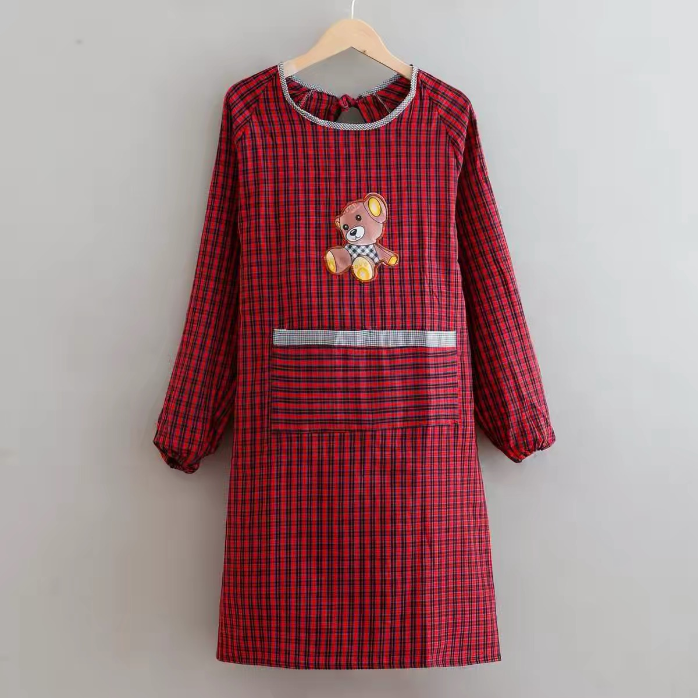

# 在 Codex 桌面版用裁光：选风格、看预览、生成六张独立图

本教程以红黑细格小熊长袖围裙为例，教你完成裁光的默认流程：

**准备素材 → 选择风格 → 六宫格方向预览 → 确认方向 → 六张独立图 → 对照验收与保存。**

适用于 **1.0.0-beta.15**。用户主动说“只做一张/先测一张”时走单张分支，见第8节。本页的可复制对话是操作示例；本轮修复按用户要求没有生图，不把示例写成已经发生的预览或六图实测。

## 1. 安装后新建 Codex 聊天

按[安装说明](INSTALL.md)安装或更新匹配的 beta.15 插件。更新后新建 Codex 聊天加载新版；旧聊天不会自动重载技能。

在技能选择器中选裁光，或在消息里输入 `$threadtruth-studio`。正常使用不需要打开 ChatGPT 网页、复制英文提示词或提供 API Key。裁光负责核对素材、安排拍摄、组织生图要求与检查结果；图片由 Codex 当前提供的内置生图能力生成，需要账号有可用额度。

## 2. 上传服饰和人物参考，先选风格

至少准备一张清楚、有权使用的真实服饰图。本案例只使用小熊款正面：

兔子款正背面属于另一商品，不能用来补小熊款背部。没有依据时，不填写材质成分、价格、功能或未知背面。

人物可以沿用已获授权的本人/品牌模特照片、已有AI人物，也可以请裁光推荐新AI人物。有真人照片时说明授权及保留范围。近脸照不证明真实全身体型或尺码，人物侧向只按已提供的清晰真实视角安排。

上传后可复制：

> 请用 $threadtruth-studio 核对这件小熊围裙和人物参考。服饰只采用小熊款，不混用兔子款。人物照片是我本人，我授权用于本次生成；沿用我的脸、发型和妆容，不沿用旧衣服、话筒、首饰和背景。先给我风格推荐和完整可选目录，等我选择，暂不生图。

**预期看到：** 简短服饰事实、一个主推、两个备选及完整24风格目录，允许自由选择任一主风格。当前生成0张，不会因为上传图片就消耗额度。你已明确选好风格时，裁光沿用该选择，不重复铺目录。

## 3. 选定风格，确认预览方案

例如选择：

> 我选日系生活感，原木暖白居家、柔和侧窗光。保留围裙的细格纹、浅色领口包边、长袖收口、小熊、大口袋与浅色口沿，保持宽松直身，不改成裙装。成片希望是2:3竖版全身。

裁光应给出这件商品与人物适用的**六宫格方向预览方案**，说明场景、搭配、画面范围和1次调用。它不应自行改成“先测一张独立图”。人物备选不变成必答问卷，已有条件不重复询问。

本例可安排燕麦色长裤、无标浅色闭口鞋，手避开小熊和大口袋；这属于拟定搭配，须随方案确认，不当作商品实拍事实。

小熊款缺少背面资料，应提前说明第六格/第六张改为正面自然站立，其余动作限制在已知正面与前侧范围。真人多角度照片不能补足衣服背面。全身人物的脸较小，目前不承诺严格锁脸或真实尺码合体。

**选择风格本身不授权生成。** 下一步才确认具体预览和次数。

## 4. 授权一次六宫格预览

确认预览方案后输入：

> 按这份方案先生成1张六宫格方向预览，标注“方向预览·非成片”，授权1次，不自动重试。先停在预览，等我确认方向。

**预期看到：** 一张包含六个拍摄方向的预览图，带非成片标记。一次预览是1次生图，不是6次；它不能拆成六张正式交付图。

重点看风格、人物方向、场景与动作编排是否合适，服饰有没有明显改款。这一步尚不替代独立成片的人物和商品验收。

若页面或工具状态不明，让裁光先恢复原请求，不反复发送相同指令。保存失败时恢复同一张原图，不因此重新生图。

## 5. 确认方向，再授权六张独立图

方向满意后输入：

> 这个方向确认。按此方向生成六张独立图，授权6次。先生成实际首张并检查，展示给我确认人物后，再继续其余五张。不要裁切预览冒充成片，不自动重试。

**默认后续数量就是六张。** 裁光不应重新问“做1张还是6张”。如果你此前已经明确授权了预览1次和成片6次，沿用原授权即可；但仍需确认实际预览方向。只说“方向可以”并不自动授权未提过的6次调用。

这条完整主线通常合计 **7次：预览1次＋独立成片6次**。默认流程不代表默认获准消耗7次，新增修正也不包含在内。

本案例的六张身体动作可按现有母版安排：

| 编号 | 身体动作 | 展示约束 |
|---|---|---|
| 1 | 轻微侧转站立 | 保持围裙正面可读，头颈自然 |
| 2 | 侧身倚墙 | 支撑自然，不靠换背景重复第一张 |
| 3 | 端正坐姿 | 衣料自然，手避开关键商品部位 |
| 4 | 正面轻步 | 步态与站姿有区别 |
| 5 | 微前倾 | 与端坐、迈步有实际身体动作区别 |
| 6 | 正面自然站立 | 缺背面时的明确替代，不编造背部 |

场景、景别和真人头向仍按已确认方案及真实素材规划；六个编号不意味着每张都复制同样脸向或家具。

## 6. 确认实际首张人物，再继续余下五张

六宫格只确认方向。进入独立成片后，裁光先生成实际第1张，核对商品、人体和文件，再展示给你。

如果人物与商品展示符合要求，可以回复：

> 这张人物和围裙展示符合我的要求，沿用这个人物。继续原已授权的其余五张。

裁光应使用原剩余五次授权逐张继续，不重复索取同一预算。原商品资料始终是衣服事实来源；原始人物参考与已确认首张分别用于人物保持，不能用首张覆盖商品细节。

如果人物不像或衣服有问题，直接指出具体偏差，先暂停首张后续：

> 这张人物还不像我，先不要继续其余五张。请对照原照指出偏差和最小修正办法，暂不重试。

实际人物接受、技术检查和商业使用验收是不同判断；预览满意不能替你接受独立首张。

## 7. 六张齐全后验收、保存

要求展示六张独立图、实际尺寸、影响使用的问题和本地文件位置。逐张对照**真实商品源**，再比较整组：

| 对象 | 核对重点 |
|---|---|
| 人物 | 脸型、眼鼻口、表观年龄、发型妆容；整组是否明显换人 |
| 围裙 | 主色、宽松直身、衣长、领袖和收口是否改变 |
| 图案与结构 | 格纹密度与方向、小熊形状与位置、大口袋、浅色口沿 |
| 动作与构图 | 六张身体动作是否有区别，头向与视线是否机械重复，手或家具是否挡住约定展示部位 |
| 文件 | 六张是否独立，实际画幅和像素是否符合统一约定 |

细格纹、小熊及围巾细节、面料和实物衣长，需要高清原照或实物对照。人物好看不能关闭明确商品错误，六张文件返回也不等于全部通过。

最终可以明确哪些图接受、哪些仍待核对，要求保存原图；不要用截图代替原图，不拉伸或强裁掩盖比例问题。发布生成内容时按适用要求标识AI生成。某张需要修正时，单独说明修改点及新增次数，保留旧图与已用次数，不重做整组。

## 8. 主动只做一张、只要提示词或停止

主动单张可在最开始提出；风格不明确时仍先选择，之后不强制六宫格：

> 本次只生成1张独立图，采用日系生活感和刚才确认的人物方案，跳过六宫格预览。授权1次，不自动扩组或重试。

这张验收后就结束，不会因为默认有六张主线而强迫再做五张。以后想续组时另提需求，裁光核对首张、商品、风格、画布及适用次数。

只看预览时回复“预览就行，不再生成”，即可结束，保留非成片说明。只要文字时说“只输出提示词，不生图”，不会调用图片生成。明确要求“不要预览，直接六张”时，仍需已有风格、方案与六次授权。

## 本页实际证据范围

2026-10-17修复了默认交互，并按要求没有新增生图。此前围裙有两次独立单张测试：一次新AI人物，一次本人真人参考，均返回1024×1536，累计2次；它们没有六宫格阶段，也不是六张组，不能证明本页默认主线已完整实图跑通。

这次验证覆盖规则一致性、现有合成本地测试、安装、打包和版本同步。真实人物还原、商品细节及新流程画面效果未作新的验证。历史真人原照、含本人身份的结果、任务记录和原始提示词保留本地，未随教程上传。

[能力说明](CAPABILITIES.md) · [素材准备](INPUT-GUIDE.md) · [模特复用](MODEL-REUSE.md)。示例商品图仅用于本项目教程，不随代码许可证授予独立转载、销售或再许可权。
